# strategy: the team AI

The robots' brain. `strategy_node.py` reads the world state from the simulator
60 times a second, gives every robot a role and a target point, and publishes
the targets. `sim/robot_node.py` drives the robots to them, simulated or real
(see the [main README](../README.md) for how the pieces connect).

It plays **both teams**: blue attacks right (+x), red attacks left.

## Set up

Nothing beyond the repo setup (`uv sync` at the repo root, see the
[main README](../README.md#set-up-step-by-step)). The learned kick policy
(`rl/`) needs the RL extra: `uv sync --extra rl`.

## Try it

The strategy node starts with the rest of the simulator, so the easiest way is:

1. Start the simulator, in the browser or a terminal:
   - `uv run robocup-web`, then **Simulator** → **Start simulator** (keep *Strategy node* on), or
   - `cd sim` then `uv run python run_pipeline.py`.
2. Turn strategy on: **Strategy (AI)** in the Game card, or key `5` in the pygame window.
   Every robot nobody is driving starts playing.
3. Things to try:
   - **Attacker dribbles** (key `0`): the attacker on the strategy's team keeps the ball.
   - **RL kick** (key `R`, 9 × 6 field only): the attacker uses the learned kick policy.
   - Drive a robot yourself (click, or **Keys**) while the others play around it.
   - With a real robot mirrored by the camera and following a sim robot, strategy
     plays it for real ([robot/README.md](../robot/README.md), step 7).

To run the node on its own (the sim must be running):

```powershell
cd strategy
uv run python strategy_node.py                # --color red: route the dribbler to red's attacker
```

| Flag | Meaning | Default |
| --- | --- | --- |
| `--mode zmq\|tcp` | How to get the world state (ZMQ is what the pipeline uses) | `zmq` |
| `--color blue\|red` | "Our" team: whose attacker gets the dribbler, and whose robots can be human-driven. Both teams are planned either way | `blue` |
| `--rl-checkpoint PATH` | Trained PPO kick policy, loaded when RL kick is first turned on | `rl/checkpoints/first_final/final.zip` |

## How it plays

`decide()` in `strategy_node.py`, every tick, for each team:

| Robots left | Roles |
| --- | --- |
| 1 | Goalie: stays on the line from its goal to the ball |
| 2 | Attacker + supporter |
| 3 | Attacker + supporter + defender |

- **Roles by distance to the ball:** closest is the attacker, then the
  supporter, then the defender. The attacker keeps its role unless a teammate is
  clearly closer (0.4 m hysteresis), so roles don't flip mid-run.
- **Attacker:** goes to a point behind the ball, lined up with the opponent's
  goal, and pushes it. If an opponent is also on the ball, it kicks it off at an
  angle to break the standoff. With RL kick on, the learned policy picks its
  target instead.
- **Supporter:** waits ahead of the ball toward the opponent's goal (on its own
  half before kickoff), facing the ball.
- **Defender:** plays goalie on the goal-to-ball line.
- **Human-driven robots** (gamepads in the pygame window) are left out, and the
  rest of the team is planned without them.

Tuning distances (`APPROACH_OFFSET`, `ATTACKER_HYSTERESIS`,
`CONTESTED_OPP_DIST`, ...) are constants at the top of `strategy_node.py`;
dribble and kick zones are in `skills/dribble.py` and `skills/kick.py`.

## Files

```
strategy/
├── strategy_node.py      # entry point: world state in, roles, targets / kicks / dribble out
├── state.py              # GameState, built from the world-state JSON each frame
├── geometry.py           # distances, goals, interpolation
├── prediction.py         # ball trajectory prediction and intercepts
├── skills/
│   ├── kick.py           # kick zone check and impulse (used by the sim's physics)
│   ├── dribble.py        # dribble capture zone (used by the sim's physics)
│   └── rl_kick.py        # wraps the trained PPO policy as a skill
├── rl/                   # the learned kick: env, reward, train, eval, checkpoints/
├── plays/, tactics/, BT/ # placeholders, see "Planned structure" below
└── stp_architecture_and_execution.svg
```

RL commands (training, evaluation) are in the [main README](../README.md#rl-kick-skill).

## Messages

In (port 9090, from `sim/simulation_node.py`): the world state, see
[sim/README.md](../sim/README.md#message-formats). Robots 0–2 are blue, 3–5 red.

Out (port 9091, to `sim/robot_node.py`), after each tick:

```json
{
  "targets": {
    "0": { "x": 5.2, "y": 3.1, "angle": 0.0 },
    "1": { "x": 6.5, "y": 4.5, "angle": 1.57 }
  },
  "attackers": [0, 3]
}
```

`angle` is the heading to face (radians, counter-clockwise from +x). Kicks and
dribbler on/off go straight to the simulator (port 9092). robot_node only uses
the targets while strategy is turned on.

## Planned structure (STP)

The goal is the STP framework: team decisions split into **plays** (what the
team does), **tactics** (what each robot does) and **skills** (how it does it),
ticked by a behavior tree. `plays/`, `tactics/`, `BT/tree.py` and
`skills/navigate.py` are empty placeholders for it; today `decide()` above does
all three.



| Layer | Planned files |
| --- | --- |
| Plays | `plays/playbook.py` picks the play; `offensive.py`, `defensive.py`, `kickoff.py` |
| Tactics | `tactics/role_assignments.py` (cost-based role auction); `attacker.py`, `supporter.py`, `defender.py` |
| Skills | `skills/navigate.py` (go-to-point, intercept), `kick.py`, `dribble.py` |
| Engine | `BT/tree.py`: plays → tactics → skills |

## References

- https://nn.cs.utexas.edu/?AB05
- https://arxiv.org/abs/2310.13396
- https://2019.robocup.org/downloads/program/OcanaEtAl2019.pdf
- https://www.cs.cmu.edu/~mmv/papers/18robocup-SchZhuVel.pdf
- https://arxiv.org/pdf/2203.13083
- https://ieeexplore.ieee.org/document/8594083
