# strategy: the team AI

The robots' brain. `strategy_node.py` reads the world state from the simulator
60 times a second, gives every robot a role and a target point, and publishes
the targets. `sim/robot_node.py` drives the robots to them, simulated or real
(see the [main README](../README.md) for how the pieces connect).

It plays **both teams**: blue attacks right (+x), red attacks left.

## Set up

Nothing beyond the repo setup (`uv sync` at the repo root, see the
[main README](../README.md#set-up-step-by-step)). The learned kick policy
(`rl/`) needs the RL extra: `uv sync --extra rl`.

## Try it

The strategy node starts with the rest of the simulator, so the easiest way is:

1. Start the simulator, in the browser or a terminal:
   - `uv run robocup-web`, then **Simulator** → **Start simulator** (keep *Strategy node* on), or
   - `cd sim` then `uv run python run_pipeline.py`.
2. Turn strategy on: **Strategy (AI)** in the Game card, or key `5` in the pygame window.
   Every robot nobody is driving starts playing.
3. Things to try:
   - **Attacker dribbles** (key `0`): the attacker on the strategy's team keeps the ball.
   - **RL kick** (key `R`, 9 × 6 field only): the attacker uses the learned kick policy.
   - Drive a robot yourself (click, or **Keys**) while the others play around it.
   - With a real robot mirrored by the camera and following a sim robot, strategy
     plays it for real ([robot/README.md](../robot/README.md), step 7).

To run the node on its own (the sim must be running):

```powershell
cd strategy
uv run python strategy_node.py                # --color red: route the dribbler to red's attacker
```

| Flag | Meaning | Default |
| --- | --- | --- |
| `--mode zmq\|tcp` | How to get the world state (ZMQ is what the pipeline uses) | `zmq` |
| `--color blue\|red` | "Our" team: whose attacker gets the dribbler, and whose robots can be human-driven. Both teams are planned either way | `blue` |
| `--rl-checkpoint PATH` | Trained PPO kick policy, loaded when RL kick is first turned on | `rl/checkpoints/first_final/final.zip` |

## How it plays

This is how it plays today. Where it's going is in [Design](#design).

`decide()` in `strategy_node.py`, every tick, for each team:

| Robots left | Roles |
| --- | --- |
| 1 | Goalie: stays on the line from its goal to the ball |
| 2 | Attacker + supporter |
| 3 | Attacker + supporter + defender |

- **Roles by distance to the ball:** closest is the attacker, then the
  supporter, then the defender. The attacker keeps its role unless a teammate is
  clearly closer (0.4 m hysteresis), so roles don't flip mid-run.
- **Attacker:** goes to a point behind the ball, lined up with the opponent's
  goal, and pushes it. If an opponent is also on the ball, it kicks it off at an
  angle to break the standoff. With RL kick on, the learned policy picks its
  target instead.
- **Supporter:** waits ahead of the ball toward the opponent's goal (on its own
  half before kickoff), facing the ball.
- **Defender:** plays goalie on the goal-to-ball line.
- **Human-driven robots** (gamepads in the pygame window) are left out, and the
  rest of the team is planned without them.

Tuning distances (`APPROACH_OFFSET`, `ATTACKER_HYSTERESIS`,
`CONTESTED_OPP_DIST`, ...) are constants at the top of `strategy_node.py`;
dribble and kick zones are in `skills/dribble.py` and `skills/kick.py`.

## Files

```
strategy/
├── strategy_node.py      # entry point: world state in, roles, targets / kicks / dribble out
├── state.py              # GameState, built from the world-state JSON each frame
├── geometry.py           # distances, goals, interpolation
├── prediction.py         # ball trajectory prediction and intercepts
├── skills/
│   ├── kick.py           # kick zone check and impulse (used by the sim's physics)
│   ├── dribble.py        # dribble capture zone (used by the sim's physics)
│   └── rl_kick.py        # wraps the trained PPO policy as a skill
├── rl/                   # the learned kick: env, reward, train, eval, checkpoints/
├── plays/, tactics/, BT/ # placeholders, see "Design" below
└── stp_architecture_and_execution.svg
```

RL commands (training, evaluation) are in the [main README](../README.md#rl-kick-skill).

## Messages

In (port 9090, from `sim/simulation_node.py`): the world state, see
[sim/README.md](../sim/README.md#message-formats). Robots 0–2 are blue, 3–5 red.

Out (port 9091, to `sim/robot_node.py`), after each tick:

```json
{
  "targets": {
    "0": { "x": 5.2, "y": 3.1, "angle": 0.0 },
    "1": { "x": 6.5, "y": 4.5, "angle": 1.57 }
  },
  "attackers": [0, 3]
}
```

`angle` is the heading to face (radians, counter-clockwise from +x). Kicks and
dribbler on/off go straight to the simulator (port 9092). robot_node only uses
the targets while strategy is turned on.

## Design

Where the strategy is going. Today `decide()` does everything in one function.
The plan keeps CMU's **Skills, Tactics and Plays** (STP) layering [1, 2]:
**plays** say what the team does, **tactics** what each robot does, **skills**
how it does it. It then changes how open play works, following what the
strongest Small Size League (SSL) teams do now [3, 4, 5, 6].

### What the teams we learn from do

| Source | What they do | What we take |
| --- | --- | --- |
| CMU STP [1] and adaptive plays [2] | A play has a condition for when it can start and one for when it's done (success, failure or timeout), and runs until one fires. Plays that work get picked more often | Plays commit instead of being re-decided every frame |
| CMDragons 2015, RoboCup champions, 48-0 over six games [3, 4] | No playbook in open play. One primary attacker acts on the ball's most likely path; a support attacker stays a fixed distance from the ball as a backup; defenders are placed from threats, each threat a task with a priority | Plays for set pieces only; open play is one continuous behaviour; threat-based defense |
| TIGERs Mannheim 2025 [5] | Every pass is generated, filtered, rated and selected. Each rating is kept apart (goal chance, interception, pressure) and chosen by priority, not summed. Interception comes from where each opponent could be t seconds from now | The attacker rates its options; decisions are made in time, not distance |
| RoboJackets [6] | A situation classifier (ball ours / free / theirs / contested, and which third of the field) picks the play; roles are requested with priorities and filled by cost | Keep "what is happening" apart from "what we do" |
| SCRAM [7] | When robots go to formation spots, pick the matching that minimises the longest trip, which keeps paths from crossing | Which robot goes to which spot |
| CMU learned skills [8] | Learn skills with reinforcement learning (RL), write tactics and plays by hand | The RL kick stays a skill |
| Behavior trees [12, 13, 14] | A tree works only if each part reports whether it applies right now and how far along it is | Every skill and play says when it applies |

### Principles

1. **The top level switches on game state, not on who has the ball.** Set
   pieces (stop, kickoff, free kick, after a goal) are separate plays. The rest
   is one open play, with an aggressiveness setting (how many robots attack)
   that follows ball position, score and time left [3, 4]. Switching on
   possession makes the team change plans whenever the ball changes hands,
   many times a second in a scramble.
2. **Plays commit.** Each play has `applicable(state)`, `done(state)` and a
   timeout, and the playbook picks again only when the current play ends or
   stops applying [1, 2].
3. **Decide in time, not distance.** Time for a robot to reach the ball, time
   before an opponent could cut off a pass [5]. Time accounts for field size
   and robot speed by itself, which fixes the `--field` issue above. The limits
   are already in `sim/config.py` (`ROBOT_MAX_SPEED`, `ROBOT_MAX_ACCEL`), and
   `sim/vision_bridge.py` already computes the same reach circle for its
   outlier gate.
4. **Roles are tasks with priorities.** For example: block the main threat,
   then primary attacker (cost: time to the ball), then support attacker or
   second defender. With 3 robots there are only 6 ways to hand out roles, so
   score them all and add a bonus for keeping the current role [3, 6]. Spots in
   a formation are matched by the longest-trip rule [7].
5. **The attacker rates its options instead of following a fixed script.**
   Candidates: push or shoot at points in the goal, dribble to a point, pass.
   Filter out the impossible ones, rate each separately (goal chance,
   interception risk, progress) and pick by priority: a good shot first, then a
   safe pass forward, then keeping the ball [4, 5]. `has_clear_shot` and
   `can_pass_ball` in `geometry.py` are the first versions of these ratings.
6. **Supporter and defenders follow CMDragons [3].** The supporter holds
   `ball + d u`, with `u` toward blocking our goal when an opponent is near the
   ball and toward their goal otherwise. Defenders stand on the line from each
   threat to our goal, or across the pass lane between threats.
7. **Learning stays at the skill level for now [8].** Skills say when they
   apply: the RL kick's in-distribution check (`rl_in_dist`) is one, and the
   attacker falls back to the classic approach when it fails. Learning above
   skills comes later: when to keep or pass [9], set pieces with several
   robots [10], or learning the tree itself [13]. RL-X [11] trains faster than
   Stable-Baselines3 if training time becomes the limit.
8. **Measure every change.** A headless match runner plays the new strategy
   against the old one, seeded, many games at a time, and reports goals,
   possession and stuck balls. Constants are tuned there, offline. TIGERs track
   their pass success and tune risk from it [5]; that kind of adaptation [2, 5]
   is for real opponents, since in the sim the AI plays itself.

### One tick

```
tick(state):
  world = analyze(state)          # once per frame: time to the ball for every robot,
                                  # threats, damped ball prediction, shot and pass ratings
  play  = playbook.current_or_select(world)       # switch on game state; plays commit
  roles = assign(play.tasks(world), our_robots)   # priority + cost over all assignments
  for robot, task in roles:
      command = task.tactic.step(world, robot)    # target, heading, kick, dribble
  return commands                                 # same message to robot_node as today
```

### Layers and files

| Layer | Job | Files |
| --- | --- | --- |
| Analysis | Everything measured once per frame, shared by the layers below | `analysis.py` (new), `prediction.py`, `geometry.py` |
| Plays | Pick what the team does; set pieces commit until done | `plays/playbook.py`, `plays/kickoff.py`; open play in `plays/offensive.py` and `plays/defensive.py`, to merge into one |
| Roles | Hand out tasks by priority and cost, keep roles stable | `tactics/role_assignments.py` |
| Tactics | One robot's behaviour; the attacker rates options | `tactics/attacker.py`, `tactics/supporter.py`, `tactics/defender.py` |
| Skills | Reusable moves with no game knowledge; each says when it applies | `skills/navigate.py`, `skills/kick.py`, `skills/dribble.py`, `skills/rl_kick.py` |
| Evaluation | Headless games, new strategy against old | `eval/match.py` (new) |

`BT/tree.py` isn't needed for this: the top level is a switch on game state in
`playbook.py`. A full behavior-tree engine [12, 13] can come back if the plays
outgrow the switch.

The strategy's own messages stay as they are, so robot_node, the Pygame window
and the web app need no change. One addition: the active play and each
robot's task (e.g. `"0": "attacker:line_up"`) in the targets message, so the
viewers can show them.

### Order of work

Each step has to match or beat the one before it in the match runner.

1. Fix the [known issues](#known-issues) in `state.py` and `prediction.py`;
   build the match runner; add tests for `decide()`.
2. Split `decide()` into tactics and skills without changing how it plays.
3. Analysis: time to reach, damped ball prediction, threats.
4. Threat-based defense and the CMDragons supporter.
5. Role assignment by priority and cost.
6. The attacker's option rating: shots, then passes.
7. Fire the real kicker: firmware, Bluetooth packet and port 9094.

### The first sketch

The original STP sketch (March 2026). It picks the open-play play from
possession, which the design above replaces. Set pieces still work this way.



## References

Architecture and plays

1. B. Browning, J. Bruce, M. Bowling, M. Veloso. "STP: Skills, tactics, and
   plays for multi-robot control in adversarial environments." *Proc. IMechE
   Part I: Journal of Systems and Control Engineering* 219(1):33-52, 2005.
   https://webdocs.cs.ualberta.ca/~bowling/publications/b2hd-05cse-stp.html
2. M. Bowling, B. Browning, M. Veloso. "Plays as Effective Multiagent Plans
   Enabling Opponent-Adaptive Play Selection." ICAPS 2004, pp. 376-383.
   https://icaps04.icaps-conference.org/icapspapers/ICAPS04BowlingM.pdf

Small Size League teams

3. J. Biswas, P. Cooksey, S. Klee, J. P. Mendoza, R. Wang, D. Zhu, M. Veloso.
   "CMDragons 2015 Extended Team Description." RoboCup 2015.
   https://ssl.robocup.org/wp-content/uploads/2019/01/2015_ETDP_CMDragons.pdf
4. J. P. Mendoza et al. "Selectively Reactive Coordination for a Team of Robot
   Soccer Champions." AAAI 2016.
   https://ojs.aaai.org/index.php/AAAI/article/view/10415
5. M. Geiger, N. Ommer, A. Ryll, M. Ratzel. "TIGERs Mannheim Extended Team
   Description for RoboCup 2025." 2025.
   https://ssl.robocup.org/wp-content/uploads/2025/04/2025_ETDP_TIGERs-Mannheim.pdf
6. RoboJackets. `rj_gameplay`: play selector, situations, role requests.
   https://rj-rc-software.readthedocs.io/en/ros2/autoapi/rj_gameplay/play_selector/index.html

Role assignment

7. P. MacAlpine, E. Price, P. Stone. "SCRAM: Scalable Collision-avoiding Role
   Assignment with Minimal-Makespan for Formational Positioning." AAAI 2015.
   https://ojs.aaai.org/index.php/AAAI/article/view/9424

Learning

8. D. Schwab, Y. Zhu, M. Veloso. "Learning Skills for Small Size League
   RoboCup." RoboCup 2018 Symposium.
   https://www.cs.cmu.edu/~mmv/papers/18robocup-SchZhuVel.pdf
9. P. Stone, R. S. Sutton, G. Kuhlmann. "Reinforcement Learning for
   RoboCup-Soccer Keepaway." *Adaptive Behavior* 13(3):165-188, 2005.
   https://nn.cs.utexas.edu/?AB05
10. J. M. Catacora Ocana, F. Riccio, R. Capobianco, D. Nardi. "Cooperative
    Multi-Agent Deep Reinforcement Learning in a 2 Versus 2 Free-Kick Task."
    RoboCup 2019 Symposium.
    https://2019.robocup.org/downloads/program/OcanaEtAl2019.pdf
11. N. Bohlinger, K. Dorer. "RL-X: A Deep Reinforcement Learning Library (not
    only) for RoboCup." arXiv:2310.13396, 2023. https://arxiv.org/abs/2310.13396

Behavior trees

12. P. Ögren, C. I. Sprague. "Behavior Trees in Robot Control Systems."
    *Annual Review of Control, Robotics, and Autonomous Systems* 5, 2022.
    https://arxiv.org/abs/2203.13083
13. B. Banerjee. "Autonomous Acquisition of Behavior Trees for Robot Control."
    IROS 2018, pp. 3460-3467. https://ieeexplore.ieee.org/document/8594083
14. L. Haug, A. A. F. Brandão, A. Casals. "Coordinating Task Switching in a
    Robotics Multi-Agent System Using Behavior Trees" (IEEE Very Small Size
    Soccer). arXiv:2606.01170, 2026. https://arxiv.org/abs/2606.01170
